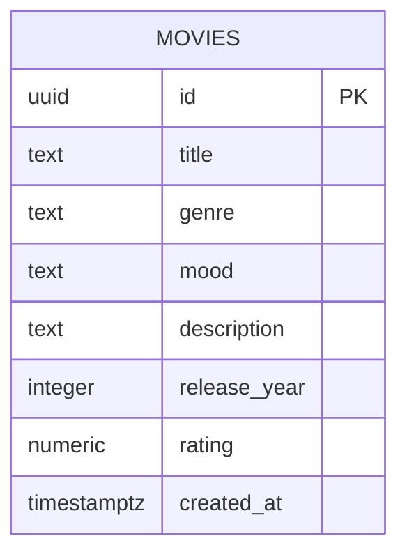

# Movie Picker – duomenų modelis

## 1. Paskirtis
Dokumentas aprašo Movie Picker aplikacijos duomenų struktūrą, lenteles, laukus, ryšius, apribojimus ir saugumo taisykles.

## 2. Lentelės
MVP naudojama viena Supabase PostgreSQL lentelė: movies.
Ji saugo 20–30 filmų katalogą.

Mėgstamiausių filmų ID saugomi naršyklės localStorage, todėl papildoma duomenų bazės lentelė nereikalinga.

## 3. Lentelės movies laukai

| Laukas | Duomenų tipas | Privalomas | Taisyklė |
|---|---|---|---|
| id | UUID | Taip | PRIMARY KEY, automatinis UUID |
| title | TEXT | Taip | NOT NULL, negali būti tuščias |
| genre | TEXT | Taip | NOT NULL, leidžiamų žanrų sąrašas |
| mood | TEXT | Taip | NOT NULL, leidžiamų nuotaikų sąrašas |
| description | TEXT | Taip | NOT NULL, negali būti tuščias |
| release_year | INTEGER | Taip | NOT NULL, nuo 1888 iki 2100 |
| rating | NUMERIC(3,1) | Taip | NOT NULL, nuo 0 iki 10 |
| created_at | TIMESTAMPTZ | Taip | NOT NULL, DEFAULT now() |

id numatytoji reikšmė: gen_random_uuid().

genre reikšmės: Komedija, Drama, Veiksmo, Romantinis, Mokslinė fantastika.

mood reikšmės: Linksma, Romantiška, Rimta, Įtempta.

## 4. Ryšiai
Duomenų bazėje yra viena lentelė, todėl nėra tarplentelinių ryšių ar užsienio raktų.

Naršyklės localStorage saugomi mėgstamiausių filmų ID turi atitikti movies.id. Pašalinto filmo ID aplikacija ignoruoja arba pašalina iš vietinio sąrašo.

## 5. ER diagrama

## 6. Apribojimai ir duomenų vientisumas
- id yra unikalus pirminis raktas.
- title ir description negali būti tušti arba sudaryti tik iš tarpų.
- genre ir mood turi atitikti leidžiamas reikšmes.
- rating turi būti tarp 0 ir 10.
- release_year turi būti tarp 1888 ir 2100.
- created_at automatiškai užpildomas dabartiniu laiku.

## 7. Saugumas
- Supabase lentelėje įjungiamas Row Level Security (RLS).
- Viešiems naudotojams leidžiama tik SELECT operacija.
- Viešiems naudotojams neleidžiamos INSERT, UPDATE ir DELETE operacijos.
- Filmų katalogą administratorius tvarko per Supabase Dashboard su tinkamomis teisėmis.
- React aplikacijoje naudojamas tik viešas Supabase publishable / anon raktas, laikantis RLS.
- Slaptas service_role raktas niekada nededamas į naršyklės kodą.

## 8. Duomenų operacijos
- SELECT – nuskaityti filmus.
- INSERT – administratoriui pridėti filmą.
- UPDATE – administratoriui atnaujinti filmą.
- DELETE – administratoriui pašalinti filmą.

## 9. MVP apribojimai
- Nėra vartotojų registracijos.
- Nėra profilių lentelės.
- Nėra mėgstamiausių filmų lentelės Supabase.
- Nėra išorinio filmų API.
- Filmų katalogas pradžioje sudaromas rankiniu būdu.

## 10. Rezultatas
Patvirtintas paprastas Movie Picker duomenų modelis, pagal kurį kitame etape bus galima sukurti Supabase lentelę ir saugumo taisykles.