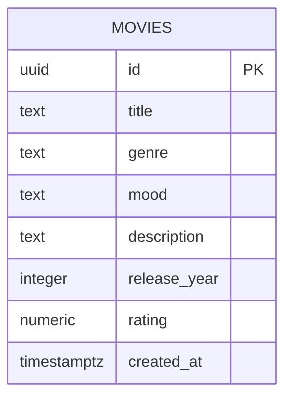

# Movie Picker duomenų modelis

Šis dokumentas aprašo šiuo metu versijuotoje Supabase migracijoje esančią duomenų struktūrą. Migracija: [`20261013170000_create_movies.sql`](../supabase/migrations/20261013170000_create_movies.sql).

## Lentelės

Duomenų bazėje yra viena aplikacijos lentelė: `public.movies`. Migracija sukuria ją su šiais laukais:

| Laukas | PostgreSQL tipas | Privalomas | Apribojimai / numatytoji reikšmė |
|---|---|---|---|
| `id` | `UUID` | Taip | Pirminis raktas; numatytoji reikšmė `gen_random_uuid()`. |
| `title` | `TEXT` | Taip | Negali būti `NULL` ar tuščias / sudarytas tik iš tarpų (`CHECK`). |
| `genre` | `TEXT` | Taip | Viena iš migracijoje išvardytų reikšmių: `Komedija`, `Drama`, `Veiksmo`, `Romantinis`, `Mokslinė fantastika`. |
| `mood` | `TEXT` | Taip | Viena iš reikšmių: `Linksma`, `Romantiška`, `Rimta`, `Įtempta`. |
| `description` | `TEXT` | Taip | Negali būti `NULL` ar tuščias / sudarytas tik iš tarpų (`CHECK`). |
| `release_year` | `INTEGER` | Taip | Reikšmė nuo 1888 iki 2100 imtinai (`CHECK`). |
| `rating` | `NUMERIC(3,1)` | Taip | Reikšmė nuo 0 iki 10 imtinai (`CHECK`). |
| `created_at` | `TIMESTAMPTZ` | Taip | Numatytoji reikšmė `now()`. |

## Ryšiai ir vietiniai duomenys

`movies` yra vienintelė migracijoje sukurta aplikacijos lentelė. Užsienio raktų ar ryšių tarp duomenų bazės lentelių nėra. Mėgstamiausi filmai laikomi naršyklės `localStorage` raktu `movie-picker-favorites`; tai nėra duomenų bazės lentelė ir ji nesinchronizuojama tarp naršyklių ar įrenginių.

## ER diagrama

## RLS ir prieigos modelis

Versijuota migracija įjungia Row Level Security (`ALTER TABLE public.movies ENABLE ROW LEVEL SECURITY`) ir sukuria politiką `Public can read movies`, kuri leidžia `SELECT` vaidmenims `anon` ir `authenticated`.

Migracijoje nėra `INSERT`, `UPDATE` ar `DELETE` politikų. Aplikacijoje yra administratoriaus prisijungimas ir filmų CRUD sąsaja, tačiau duomenų bazės rašymo prieiga turi būti atskirai apribota RLS politikomis. Galimų administratoriaus CRUD politikų Supabase Dashboard aplinkoje iš šio repozitorijaus patikrinti negalima. Realaus projekto politikas reikia patikrinti Dashboard aplinkoje arba Supabase administravimo priemonėmis; vien administratoriaus vaidmens patikros aplikacijoje nepakanka duomenų bazės prieigai apriboti.

## Validavimas

Forma prieš siunčiant tikrina privalomus pavadinimo, žanro, nuotaikos ir aprašymo laukus, išleidimo metų intervalą 1888–2100 bei įvertinimo intervalą 0–10. Migracija šiuos duomenų bazės laukus taip pat riboja `NOT NULL` ir `CHECK` apribojimais. Pavadinimui ir aprašymui sąsajoje nustatyti atitinkamai 200 ir 2000 simbolių limitai; tokio ilgio limitai pateiktoje migracijoje nenustatyti.
